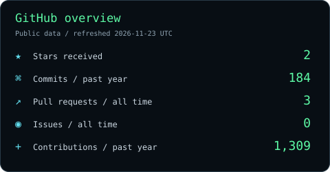
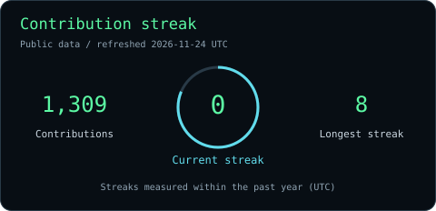
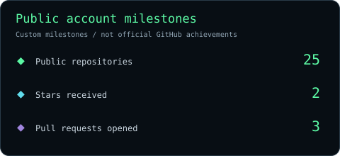
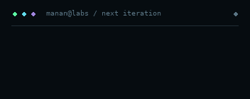

<div align="center">

[](assets/ascii-portrait.png)

# Hi, I'm **Manan Mittal** 👋


```text
Building the future,
one line of code at a time.
```

AI Engineer | Full Stack Developer | Game Dev Aspirant


</div>

---

## 🎯 What I Do

I build intelligent applications, full-stack products, and enterprise workflows—from architecture to implementation and deployment.

---

## 📡 Connect With Me

[](https://www.linkedin.com/in/manan-mittal1123482/)
[](https://github.com/MananLabs)
[](mailto:mittalmanan81@gmail.com)
[](https://x.com/Manan1123482)

---

## 👨‍💻 About Me

I’m pursuing B.Tech in Computer Science and Engineering, specializing in Artificial Intelligence and Machine Learning, at **REVA University, Bengaluru**. My interests span AI/ML and LLM engineering, full-stack development, enterprise software, system architecture, and game development.

---

## 🛠️ Tech Stack

**💻 Languages**


**🎨 Frontend**


**⚙️ Backend**


**🗄️ Databases**


**🧠 AI / ML**


**🔧 Tools**


---

## 🚀 Featured Projects

### 🧠 AI & Intelligent Systems

**📚 Power Electronics LLM** — Textbook-grounded question answering over *Fundamentals of Power Electronics* using embeddings and RAG.

 

**🩺 DDXPlus Medical Diagnostic Support System** — Diagnostic-support project using the DDXPlus dataset, embeddings, and vector retrieval.

  

**🌿 [CareNest](https://github.com/MananLabs/Dementia_Care)** — AI-powered dementia care with family and caregiver workflows.

   

**🚚 [FLOWGRID](https://github.com/MananLabs/build-flowgrid-logistics-platform)** — Logistics orchestration with shipment matching, route optimization, simulation, and simulated live tracking.

  

**💡 SocialIQ** — An AI-powered social intelligence project.


### ⚡ Full-Stack & Product Engineering

**🧩 VEL AI** — An infinite multi-agent AI operating workspace for coordinating agents and workflows.

   

**🍽️ FoxDine** — Restaurant management with QR ordering, kitchen dashboards, waiter workflows, and administration.


**✈️ [Airway](https://github.com/MananLabs/Airway)** — An airport ride-sharing prototype for Mumbai arrivals.

  

### 🏢 Enterprise & Business Systems

**🧾 GST Reconciliation** — Financial data matching and reconciliation between Zoho Books and GST Portal data.

 

**⏱️ Overtime Application** — An enterprise overtime management application.


**🔗 Odoo CRM / ERP** — Experience with CRM stages, activity workflows, and spreadsheet imports.

---

## 📊 GitHub Statistics

<div align="center">






[View my GitHub activity](https://github.com/MananLabs)

</div>

---

## 📈 Contributions

<div align="center">


</div>

---

## 🐍 Contribution Snake

<div align="center">


</div>

---

## 🏆 GitHub Trophies

<div align="center">



</div>

<sub>Dashboard images refresh through GitHub Actions; until the first run, they show setup status. Milestones are custom data summaries, not official GitHub achievement badges. <a href="IMPLEMENTATION_REPORT.md#enable-dashboard-and-snake">Setup details</a>.</sub>

---

## 🎮 Goals & Vision

Build dependable AI systems, deepen my systems engineering skills, and explore intelligent game experiences.

<div align="center">



**Always building. Always learning. Always engineering.**

</div>
