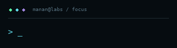

  

<h1 align="center">MANAN MITTAL</h1>

  

<strong>Building intelligent systems. Engineering real-world solutions.</strong>

AI/ML Engineer · Full-Stack Developer Systems Developer · Aspiring Game Developer

<a href="#about">About</a> · <a href="#technical-expertise">Stack</a> · <a href="#featured-projects">Projects</a> · <a href="#github-activity">Activity</a> · <a href="#connect">Connect</a>

---

## About

I’m Manan, focused on AI engineering, full-stack products, and practical enterprise software. My academic background is B.Tech in Computer Science and Engineering, specializing in Artificial Intelligence and Machine Learning, at **REVA University, Bengaluru, India**.

I enjoy taking ideas from architecture through implementation and deployment: grounding LLMs in useful knowledge, coordinating AI agents, building dependable APIs, and designing systems that can scale.

**Current interests:** LLMs, retrieval-augmented generation, enterprise applications, and scalable systems. Game development is a direction I’m exploring alongside that work.

## Technical expertise

**⌘ Languages**

`Python` · `C` · `C++` · `Java` · `JavaScript` · `TypeScript` · `SQL`

**◇ Frontend**

`React` · `Next.js` · `React Native` · `Tailwind CSS` · `Framer Motion`

**⚙ Backend**

`Node.js` · `NestJS` · `Flask` · `FastAPI` · `REST APIs`

**▤ Databases & data platforms**

`PostgreSQL` · `MySQL` · `MongoDB` · `Supabase` · `Firebase` · `Qdrant`

**✳ AI / ML**

`LLMs` · `RAG` · `Vector Embeddings` · `Sentence Transformers` · `Model Integration` · `AI Agent Orchestration`

**⌁ Infrastructure & tools**

`Git` · `GitHub` · `Docker` · `Linux` · `Cloud Deployment`

## Featured projects

### 01 / LLM — Fundamentals of Power Electronics

Textbook-grounded question answering built around *Fundamentals of Power Electronics*. Document processing, embeddings, and retrieval-augmented generation connect questions to relevant source material.

**Technology focus:** LLM integration · document processing · vector embeddings · RAG

### 02 / VEL AI

An infinite multi-agent AI operating workspace designed to coordinate intelligent agents and workflows.

**Technology focus:** AI agents · multi-agent orchestration · workflow coordination

### 03 / FLOWGRID

An autonomous logistics orchestration platform designed to reduce empty truck miles through intelligent shipment matching, optimization, simulation, and AI-driven disruption recovery.

**Technology focus:** optimization · simulation · AI-driven orchestration

### 04 / GST Reconciliation

A reconciliation solution integrating Zoho Books and GST Portal data to streamline financial reconciliation workflows.

**Integration focus:** Zoho Books · GST Portal data · reconciliation workflows

### 05 / FoxDine

A restaurant management platform connecting QR-based ordering, kitchen workflows, waiter dashboards, and administrative controls.

**Technology focus:** QR-based ordering · operational dashboards · workflow management

### 06 / Overtime Application

An enterprise application for managing overtime workflows and related operational processes.

**Engineering focus:** enterprise applications · overtime workflow management

### 07 / SocialIQ

A social intelligence project. Further implementation details will be added when project documentation is available.

<!-- Project repository URLs, demos, and framework names are intentionally omitted until verified.
     SocialIQ's scope and technology stack have not been established from available sources. -->

## GitHub activity

[Explore my repositories and contribution history →](https://github.com/MananLabs?tab=repositories)

Cards are provided by external services and may be temporarily unavailable. Language statistics describe public repository composition.

---

## Connect

Interested in AI systems, full-stack engineering, or enterprise software? Let’s connect.

[LinkedIn](https://www.linkedin.com/in/manan-mittal1123482/) · [GitHub](https://github.com/MananLabs) · [Email](mailto:mittalmanan81@gmail.com) · [Twitter / X](https://x.com/Manan1123482)

<strong>Always building. Always learning. Always engineering.</strong>

