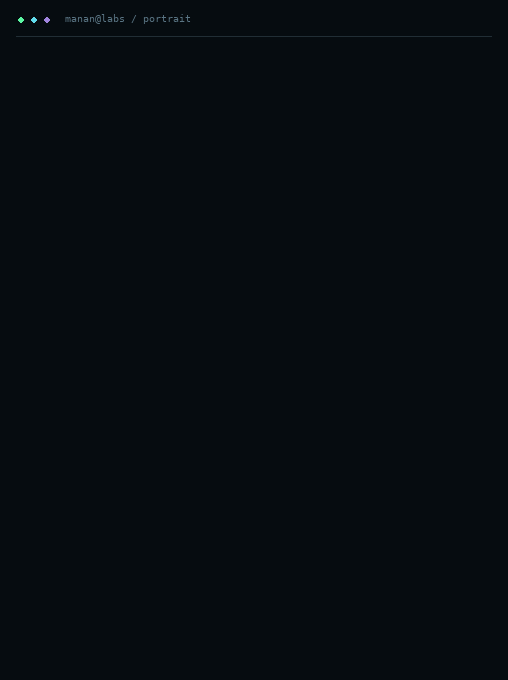
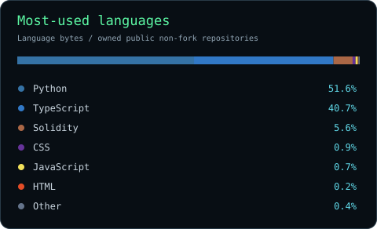
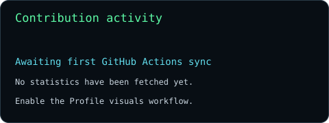

<div align="center">

[](assets/ascii-portrait.png)

# Hi, I'm **Manan Mittal** 👋


```text
Building the future,
one line of code at a time.
```

AI Engineer | Full Stack Developer | Game Dev Aspirant


</div>

---

<div align="center">

## 🎯 What I Do

**AI systems · Full-stack products · Enterprise software**

### 📡 Connect With Me

[](https://www.linkedin.com/in/manan-mittal1123482/)
[](https://github.com/MananLabs)
[](mailto:mittalmanan81@gmail.com)
[](https://x.com/Manan1123482)


### 👨‍💻 About Me

Pursuing **B.Tech CSE (AI & ML)** at **REVA University, Bengaluru**.

</div>

---

<div align="center">

## 🛠️ Tech Stack

<p><strong>💻 Languages</strong><br>


</p>

<p><strong>🎨 Frontend</strong><br>


</p>

<p><strong>⚙️ Backend</strong><br>


</p>

<p><strong>🗄️ Databases</strong><br>


</p>

<p><strong>🧠 AI / ML</strong><br>


</p>

<p><strong>🔧 Tools</strong><br>


</p>

<details>
<summary>More technologies</summary>

<p>


</p>

</details>

</div>

---

## 🚀 Featured Projects

### 🧠 AI & Intelligent Systems

- **📚 Power Electronics LLM** — Textbook Q&A with embeddings and RAG.
- **🩺 DDXPlus** — Diagnostic support using embeddings and vector retrieval.
- **🌿 [CareNest](https://github.com/MananLabs/Dementia_Care)** — AI-assisted dementia care and caregiver workflows.
- **🚚 [FLOWGRID](https://github.com/MananLabs/build-flowgrid-logistics-platform)** — Shipment matching, route optimization, and simulated tracking.
- **💡 SocialIQ** — AI-powered social intelligence.

### ⚡ Full-Stack & Product Engineering

- **🧩 VEL AI** — Multi-agent workspace built with Next.js and NestJS.
- **🍽️ FoxDine** — QR ordering and restaurant operations.
- **✈️ [Airway](https://github.com/MananLabs/Airway)** — Mumbai airport ride-sharing prototype in React Native.

### 🏢 Enterprise & Business Systems

- **🧾 GST Reconciliation** — Zoho Books ↔ GST Portal data matching.
- **⏱️ Overtime Application** — Enterprise overtime management.
- **🔗 Odoo CRM / ERP** — CRM workflows, configuration, and spreadsheet imports.

---

## 📊 GitHub Statistics

<div align="center">




[View my GitHub activity](https://github.com/MananLabs)

</div>

---

## 📈 Contributions

<div align="center">



</div>

---

## 🐍 Contribution Snake

<div align="center">


</div>

---

## 🏆 GitHub Trophies

<div align="center">


</div>

<sub>Dashboard images refresh through GitHub Actions; until the first run, they show setup status. Milestones are custom data summaries, not official GitHub achievement badges. <a href="IMPLEMENTATION_REPORT.md#enable-dashboard-and-snake">Setup details</a>.</sub>

---

## 🎮 Goals & Vision

Build dependable AI systems, deepen my systems engineering skills, and explore intelligent game experiences.

<div align="center">


**Always building. Always learning. Always engineering.**

</div>
